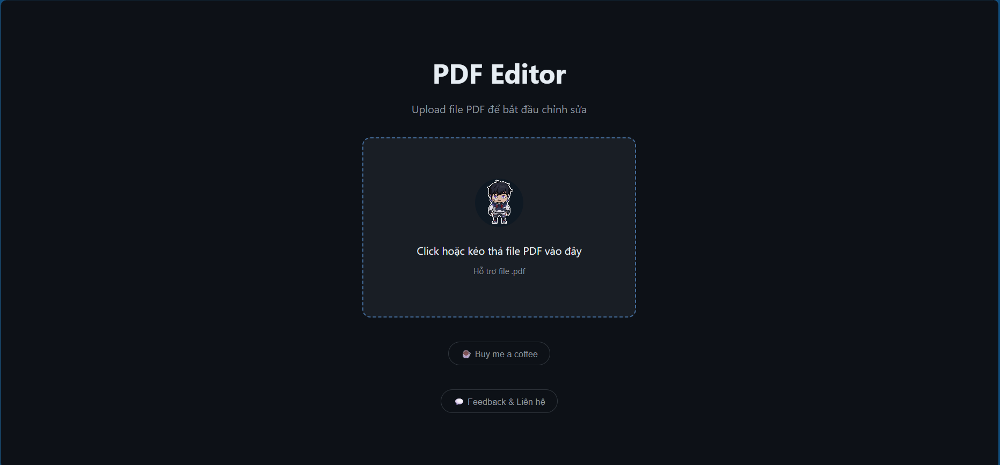
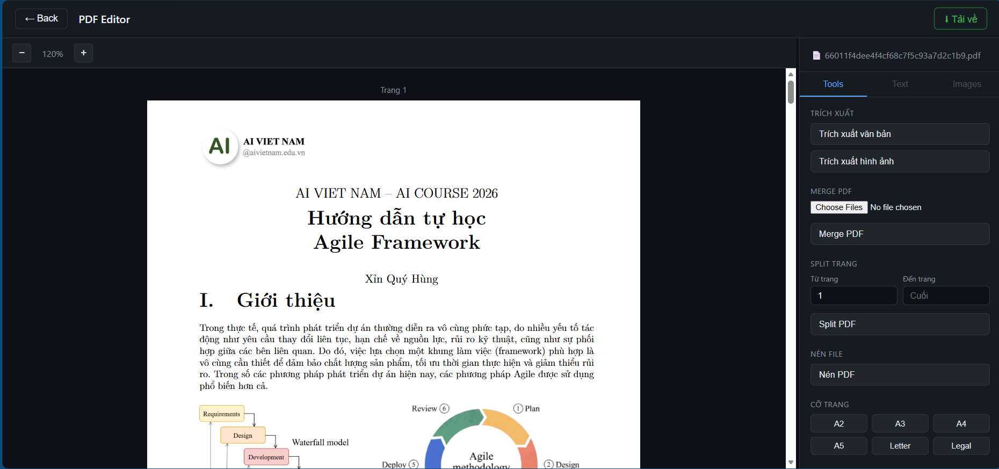
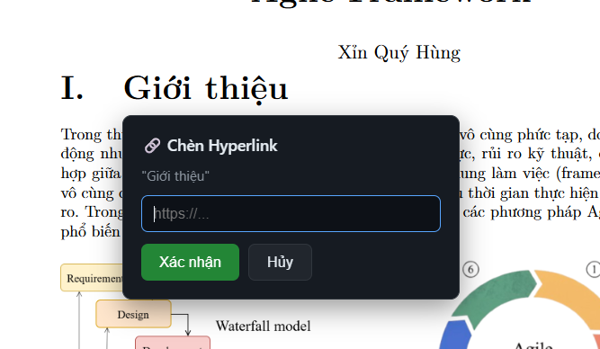
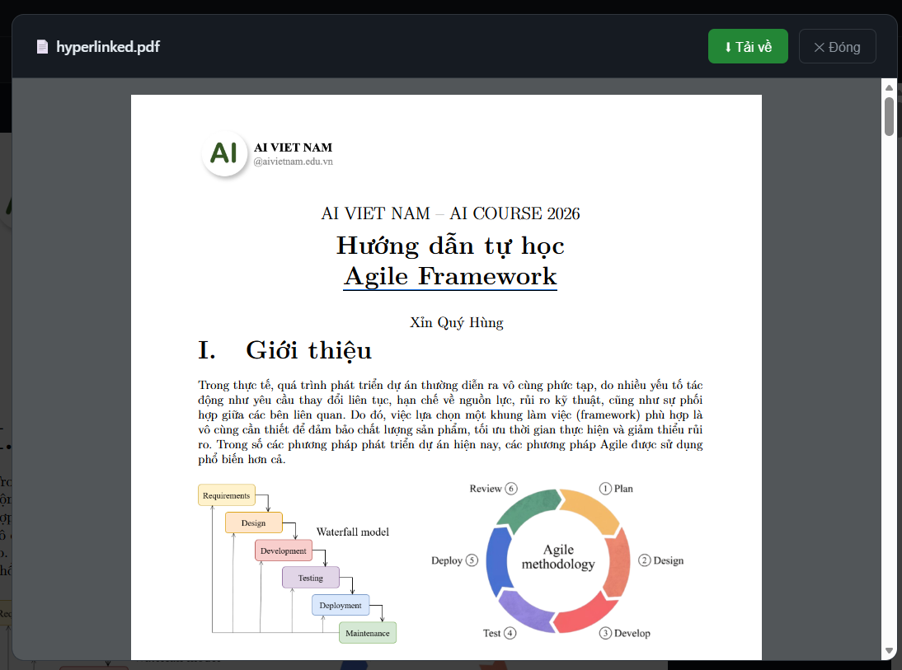

# PDF Editor

A full-stack web application for viewing and editing PDF files directly in the browser.

**Live demo:** https://pdf-editor-prj.vercel.app

---

## Demo

<!-- Insert demo screenshot here -->


---

## Features

- **PDF Viewer** — render multi-page PDFs with zoom in/out and resizable sidebar
- **Extract** — extract text content or images from a PDF
- **Merge** — combine multiple PDF files into one
- **Split** — extract a page range from a PDF into a new file
- **Remove watermark** — inspect and remove selected stamps or separate image/Form objects with before/after preview
- **Compress** — reduce PDF file size
- **Hyperlink** — select text and insert a clickable URI annotation with underline style
- **Preview before download** — all operations show a preview modal; download only when satisfied

---

## Tech Stack

| Layer    | Technology                          |
|----------|-------------------------------------|
| Frontend | React 19, Vite, react-pdf (pdfjs)   |
| Backend  | FastAPI, Python, pypdf, PyMuPDF     |
| Deploy   | Vercel (frontend), Render (backend) |

---

## Screenshots

### Home

<!-- Insert home page screenshot here -->


### PDF Viewer & Sidebar

<!-- Insert editor screenshot here -->


### Hyperlink Insertion

<!-- Insert hyperlink demo screenshot here -->


### Preview Modal

<!-- Insert preview modal screenshot here -->


---

## Getting Started

### Prerequisites

- Node.js >= 18
- Python >= 3.10
- Conda (recommended)

### Backend

```bash
cd backend
conda create -n pdf-editor python=3.11
conda activate pdf-editor
pip install fastapi uvicorn pypdf pymupdf python-multipart
uvicorn main:app --reload
```

Backend runs at `http://localhost:8000`.

### Frontend

```bash
cd frontend
npm install
npm run dev
```

Frontend runs at `http://localhost:5173`.

---

## Project Structure

```
pdf-editor/
├── backend/
│   ├── main.py
│   └── routers/
│       ├── compress.py
│       ├── extract.py
│       ├── hyperlink.py
│       └── merge_split.py
└── frontend/
    └── src/
        ├── components/
        │   ├── HyperlinkPopup.jsx
        │   ├── PDFViewer.jsx
        │   ├── ResultPreview.jsx
        │   └── Sidebar.jsx
        ├── pages/
        │   ├── Editor.jsx
        │   └── Home.jsx
        └── services/
            └── api.js
```

---

## Deployment

- **Frontend** — push to `main`, Vercel auto-deploys from `frontend/`
- **Backend** — push to `main`, Render auto-deploys from `backend/`

The frontend uses `import.meta.env.DEV` to switch between local (`localhost:8000`) and production (Render) API automatically.

---

## License

MIT


## Remove watermarks (MVP)

Open a PDF, choose **Xóa watermark → Phân tích PDF**, and inspect candidates with **Xem trước ứng viên**. Select objects, optionally restrict pages (for example `1, 3-5`), then choose **Tạo PDF đã xóa**. Download the result or choose **Áp dụng** to continue editing it. **Khôi phục bản gốc** restores the upload.

Supported: groups of faint curved vector fills inside marked artifacts (including outlined Word watermarks), separate text objects whose visible runs are all tilted or faint, Watermark/Stamp annotations, and individual page-level Image/Form XObject drawing operations. Text-show operations are removed while retaining font, positioning and spacing state; mixed body/watermark text objects and clipping text are excluded. Candidates are structural objects, not automatically confirmed watermarks. A Form may contain legitimate content; inspect before/after previews. Nested objects inside Forms, mixed-content text objects, inline images, arbitrary/unmarked vector paths, and watermarks baked into scan pixels are not independently supported.

Removal changes only selected invocations, preserving shared objects still used elsewhere. Unused resources are cleaned up on export. Requests verify the SHA-256 fingerprint and rescan candidate IDs. Limits: 20 MiB, 100 pages, 1000 candidates. Unlock encrypted PDFs first. PDF modifications invalidate existing digital signatures.

API (multipart upload):

- `POST /api/watermark/analyze`: `file`; returns fingerprint, page count, candidates.
- `POST /api/watermark/preview`: `file`, `options` JSON containing fingerprint and one selected ID; returns before/after page PNGs as base64.
- `POST /api/watermark/remove`: `file`, `options` JSON containing fingerprint and selected IDs; returns PDF.

Uses existing pikepdf and PyMuPDF dependencies. CPU work runs in FastAPI’s thread pool. Upload limits do not impose a hard CPU/memory bound for decompression-heavy PDFs; production at scale should isolate processing in workers with enforced resource limits.

Backend tests (install backend requirements and httpx first):

```bash
cd backend
python -m unittest discover -s tests -v
```

Regression coverage includes shared images/Forms, duplicate image occurrences, stamp removal, text/hyperlink preservation, rotated pages, stale selections, malformed/encrypted PDFs, page limits, and API previews.
